# Pendant 畫面命名與截圖

每一張圖都是 App 本身（背景透明），用同一個名稱當檔名。Mac 版與 Windows 版對照時，請用這裡的名稱稱呼每個畫面。

- 截圖由 macOS 版除錯模式自動拍攝，資料全是替代文字（歌曲名稱、歌手名稱、專輯名稱）與假的行事曆／待辦，沒有任何個人資料。
- 用全新的預設設定拍攝，所以是出貨時的樣子，不是某個人的自訂版面。
- 尺寸是 2 倍解析度（Retina）的實際像素。

## 沒有收錄的畫面

- **設定視窗各頁**、**開發者視窗**、**首次導覽**：是獨立視窗，不是膠囊。
- **彈出視窗**（音量滑桿、輸出裝置、日期與選項選擇器）：是系統彈出視窗，不屬於膠囊本體。
- **筆記**、**捷徑**小工具：目前預設沒有啟用，且捷徑會列出個人的捷徑，所以沒有拍。
- **拖著檔案進入時的提示**（「放開即可加入檔案抽屜」）與**各種權限提示**：需要真的拖曳或系統授權狀態，沒辦法自動拍。

## A. 有實體瀏海的螢幕

瀏海是硬體，膠囊從它長出來；內容放在瀏海兩側與下方。

### 1. 小膠囊（有活動時的常駐狀態）

| 名稱 | 說明 | 圖 |
|---|---|---|
| **閒置** | 沒有任何活動時的膠囊：只有瀏海大小的黑色形狀（虛擬瀏海會顯示電量與時間）。 |  |
| **閒置·滑過膨脹** | 游標碰到閒置的膠囊，整體稍微變大（寬×1.08、高×1.22）並有陰影。 |  |
| **音樂（播放）** | 小膠囊：左邊專輯封面，右邊音波。 |  |
| **音樂（暫停）** | 小膠囊：暫停時右邊顯示三個點，封面照舊。 |  |
| **音樂·滑過封面** | 游標在封面那一側：膠囊膨脹，下方顯示歌曲與歌手。 |  |
| **音樂·滑過控制** | 游標在右側：膠囊膨脹，右邊變成播放／暫停按鈕。 |  |
| **音樂·顯示歌名** | 換歌（或滑過封面）時，膠囊變高並在下方顯示歌曲與歌手。 |  |
| **音樂·切到下一首** | 在小膠囊用兩指向左滑：左邊出現「下一首」圖示，膠囊向該側拉長。 |  |
| **音樂·切到上一首** | 兩指向右滑：右邊出現「上一首」圖示。 |  |
| **計時器（倒數）** | 小膠囊：左邊倒數圖示，右邊剩餘時間與進度線。 |  |
| **計時器·時間到通知** | 倒數結束：膠囊膨脹、閃白框，顯示「計時結束／點一下查看」。 |  |
| **碼錶** | 小膠囊：左邊碼錶圖示，右邊經過時間。 |  |
| **檔案中轉站** | 小膠囊：左邊檔案抽屜圖示，右邊檔案數量。 |  |
| **多個活動（主島與副島）** | 同時有兩個以上活動：主島（音樂）在中間，其他活動（計時器）變成旁邊的副島。 |  |

### 2. 音量、亮度膠囊與系統提示卡片

| 名稱 | 說明 | 圖 |
|---|---|---|
| **音量膠囊** | 按音量鍵：膠囊自己拉寬，左圖示與「音量」，右邊百分比與進度條。 |  |
| **亮度膠囊** | 按亮度鍵：同上，圖示是太陽（光芒隨亮度變長）。 |  |
| **靜音膠囊** | 靜音時：喇叭加斜線圖示，顯示靜音前的音量。 |  |
| **低音量膠囊** | 音量很低時：喇叭波紋只剩一點點。 |  |
| **充電中卡片** | 接上電源：膠囊長成卡片，左邊綠色圓環與閃電，中間「充電中」，右邊電量。 |  |
| **低電量卡片** | 電量低於門檻：紅色圓環，「低電量／請盡快充電」。 | 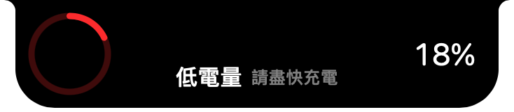 |
| **藍牙連接卡片** | 藍牙裝置連上：藍色圓環與藍牙符號，中間裝置名稱與電量，右邊裝置類型圖示。 |  |

### 3. 展開面板（大膠囊）

| 名稱 | 說明 | 圖 |
|---|---|---|
| **小工具頁（全部）** | 展開後的「小工具」分頁：音樂、行事曆、待辦事項、計時器、鏡子並排。 | 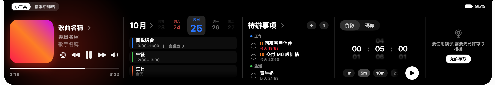 |
| **音樂** | 展開面板中只有音樂小工具。 | 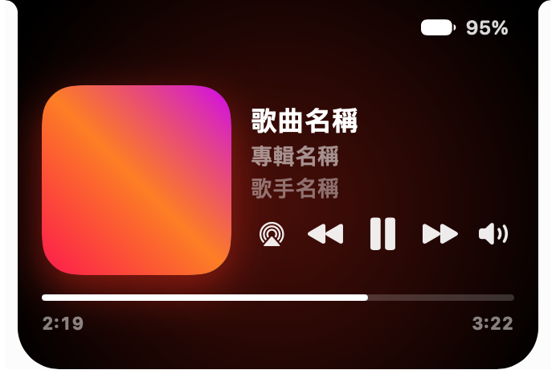 |
| **音樂（沒有播放）** | 沒有任何播放來源時的音樂小工具。 | 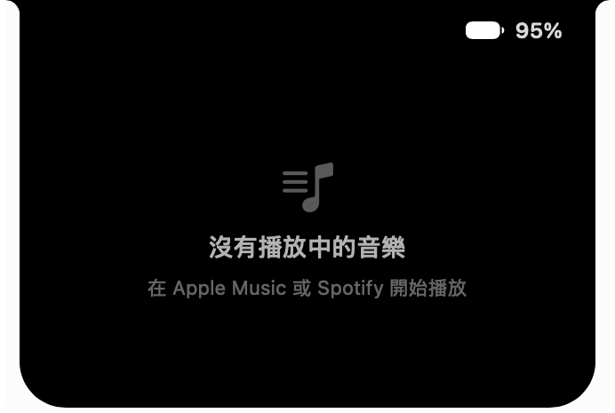 |
| **待辦事項** | 待辦事項小工具：依分類列出，右上角有「＋」與未完成數量。 | 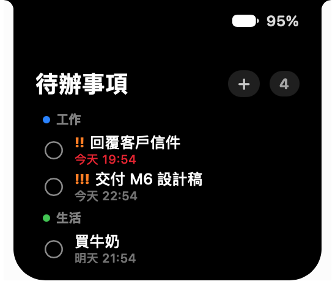 |
| **待辦事項·新增待辦** | 按「＋」後（擠換動畫）清單換成新增待辦的輸入框，＋變成 ×。 | 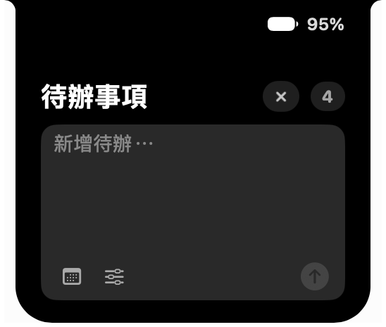 |
| **行事曆** | 行事曆小工具：月份、日期條與當天活動。 | 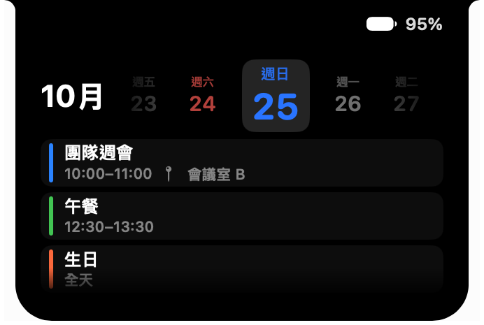 |
| **計時器** | 計時器小工具（倒數與碼錶分頁，未開始）。 | 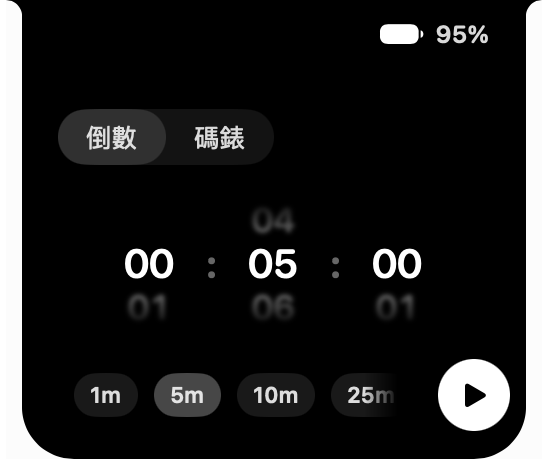 |
| **計時器·倒數中** | 計時器小工具：倒數進行中，顯示大數字、進度線、重設與暫停。 | 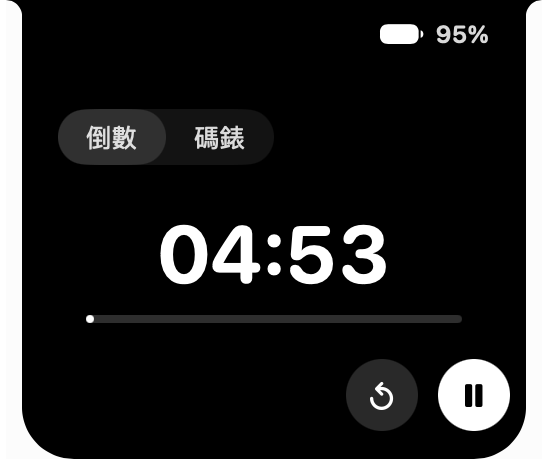 |
| **鏡子（需要相機權限）** | 鏡子小工具尚未取得相機權限時的畫面。 | 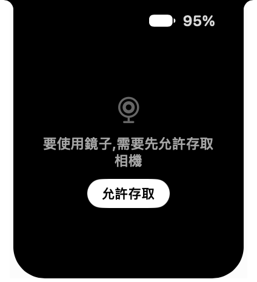 |
| **檔案中轉站** | 檔案中轉站分頁：左邊檔案抽屜，右邊 AirDrop 區。 | 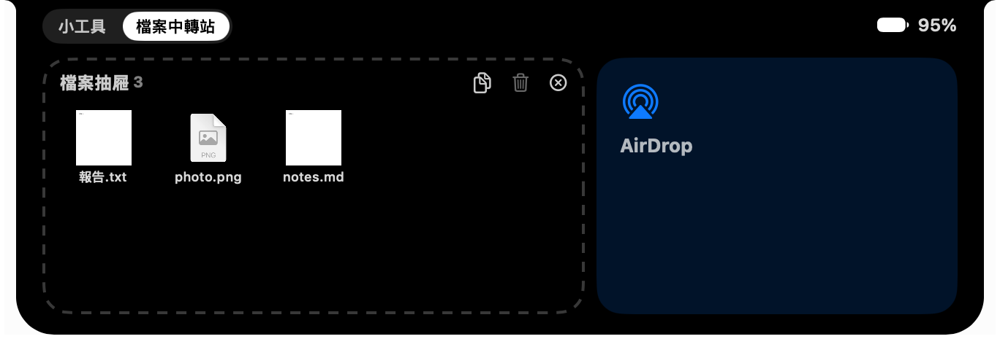 |

### 4. 單獨膠囊（只顯示一個小工具的詳細頁）

| 名稱 | 說明 | 圖 |
|---|---|---|
| **音樂獨立膠囊（有歌詞）** | 單獨膠囊：左邊播放器，右邊同步歌詞（目前行白色置中）。 | 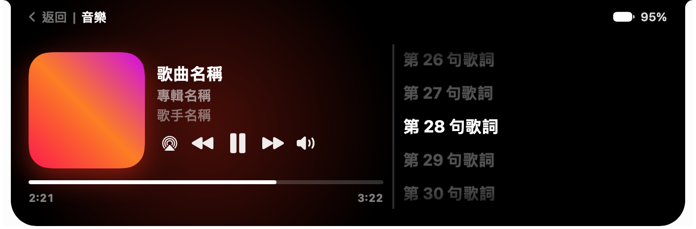 |
| **音樂獨立膠囊（無歌詞）** | 單獨膠囊：沒有歌詞時右邊顯示「沒有歌詞」。 | 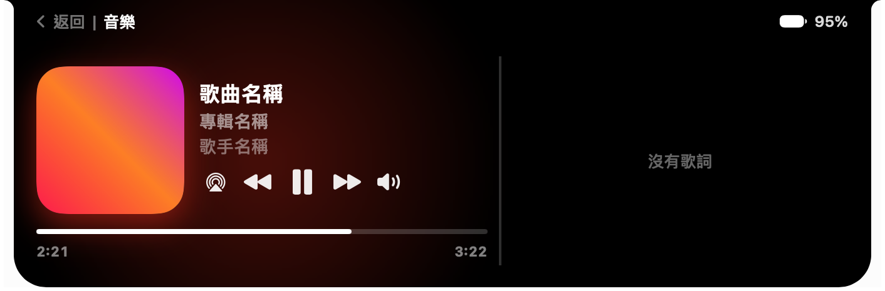 |
| **日曆獨立膠囊** | 單獨膠囊：日期條填滿寬度、今天靠左，活動以磚塊由左到右排列。 | 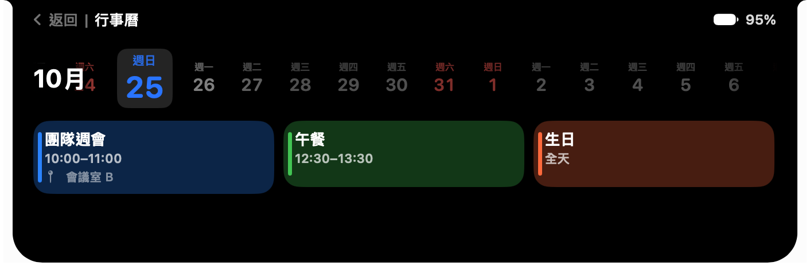 |
| **待辦事項獨立膠囊** | 單獨膠囊：左邊清單，右邊新增待辦輸入框。 | 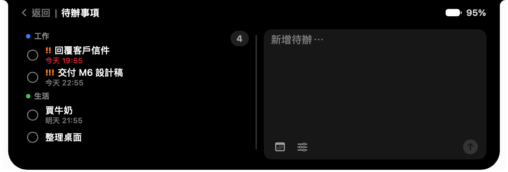 |

## B. 沒有實體瀏海的螢幕（虛擬瀏海）

Windows 版一律是這一種：頂端置中的浮動膠囊，閒置時就有電量與時間，提示卡片是一條窄卡片。

### 1. 小膠囊（有活動時的常駐狀態）

| 名稱 | 說明 | 圖 |
|---|---|---|
| **閒置** | 沒有任何活動時的膠囊：只有瀏海大小的黑色形狀（虛擬瀏海會顯示電量與時間）。 |  |
| **閒置·滑過膨脹** | 游標碰到閒置的膠囊，整體稍微變大（寬×1.08、高×1.22）並有陰影。 |  |
| **音樂（播放）** | 小膠囊：左邊專輯封面，右邊音波。 |  |
| **音樂（暫停）** | 小膠囊：暫停時右邊顯示三個點，封面照舊。 |  |
| **音樂·滑過封面** | 游標在封面那一側：膠囊膨脹，下方顯示歌曲與歌手。 |  |
| **音樂·滑過控制** | 游標在右側：膠囊膨脹，右邊變成播放／暫停按鈕。 |  |
| **音樂·顯示歌名** | 換歌（或滑過封面）時，膠囊變高並在下方顯示歌曲與歌手。 |  |
| **音樂·切到下一首** | 在小膠囊用兩指向左滑：左邊出現「下一首」圖示，膠囊向該側拉長。 |  |
| **音樂·切到上一首** | 兩指向右滑：右邊出現「上一首」圖示。 |  |
| **計時器（倒數）** | 小膠囊：左邊倒數圖示，右邊剩餘時間與進度線。 |  |
| **計時器·時間到通知** | 倒數結束：膠囊膨脹、閃白框，顯示「計時結束／點一下查看」。 |  |
| **碼錶** | 小膠囊：左邊碼錶圖示，右邊經過時間。 |  |
| **檔案中轉站** | 小膠囊：左邊檔案抽屜圖示，右邊檔案數量。 |  |
| **多個活動（主島與副島）** | 同時有兩個以上活動：主島（音樂）在中間，其他活動（計時器）變成旁邊的副島。 |  |

### 2. 音量、亮度膠囊與系統提示卡片

| 名稱 | 說明 | 圖 |
|---|---|---|
| **音量膠囊** | 按音量鍵：膠囊自己拉寬，左圖示與「音量」，右邊百分比與進度條。 |  |
| **亮度膠囊** | 按亮度鍵：同上，圖示是太陽（光芒隨亮度變長）。 |  |
| **靜音膠囊** | 靜音時：喇叭加斜線圖示，顯示靜音前的音量。 |  |
| **低音量膠囊** | 音量很低時：喇叭波紋只剩一點點。 |  |
| **充電中卡片** | 接上電源：膠囊長成卡片，左邊綠色圓環與閃電，中間「充電中」，右邊電量。 |  |
| **低電量卡片** | 電量低於門檻：紅色圓環，「低電量／請盡快充電」。 |  |
| **藍牙連接卡片** | 藍牙裝置連上：藍色圓環與藍牙符號，中間裝置名稱與電量，右邊裝置類型圖示。 |  |

### 3. 展開面板（大膠囊）

| 名稱 | 說明 | 圖 |
|---|---|---|
| **小工具頁（全部）** | 展開後的「小工具」分頁：音樂、行事曆、待辦事項、計時器、鏡子並排。 | 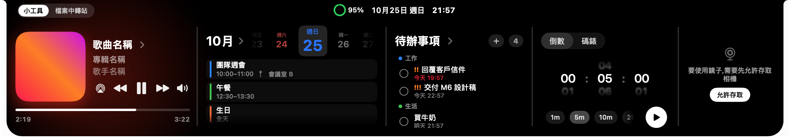 |
| **音樂** | 展開面板中只有音樂小工具。 | 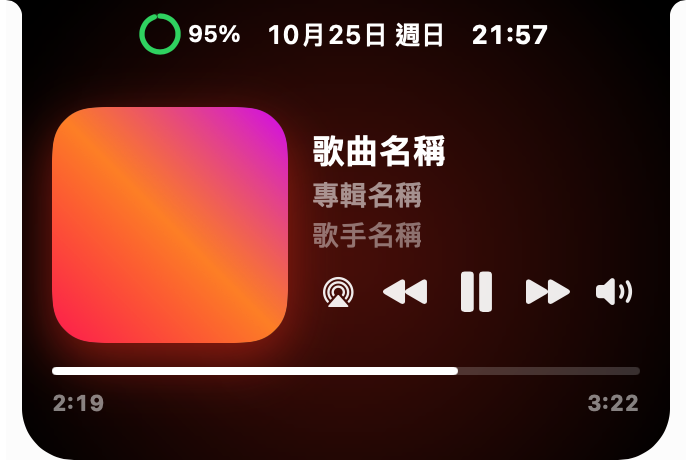 |
| **音樂（沒有播放）** | 沒有任何播放來源時的音樂小工具。 | 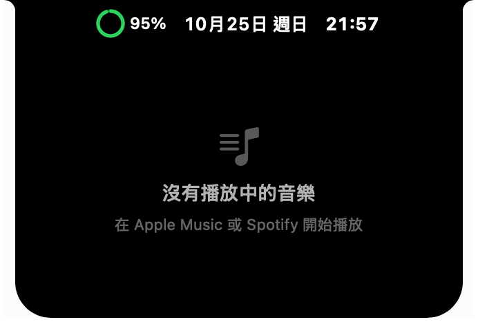 |
| **待辦事項** | 待辦事項小工具：依分類列出，右上角有「＋」與未完成數量。 | 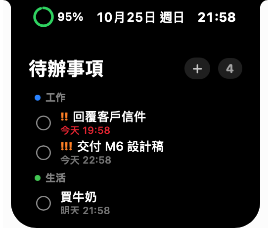 |
| **待辦事項·新增待辦** | 按「＋」後（擠換動畫）清單換成新增待辦的輸入框，＋變成 ×。 |  |
| **行事曆** | 行事曆小工具：月份、日期條與當天活動。 | 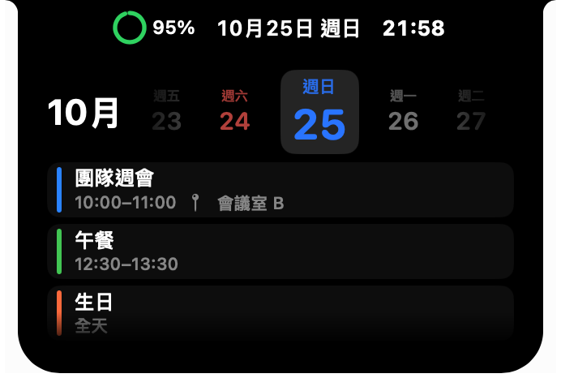 |
| **計時器** | 計時器小工具（倒數與碼錶分頁，未開始）。 | 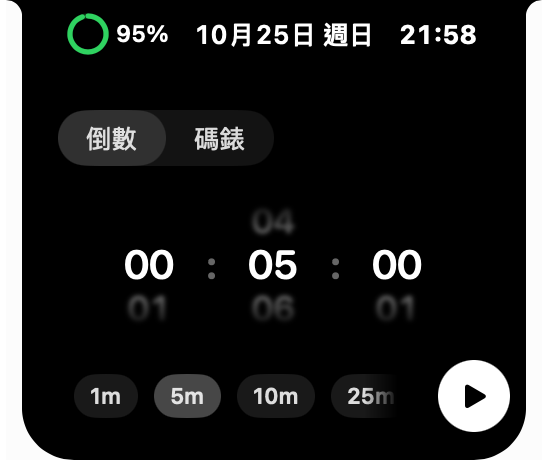 |
| **計時器·倒數中** | 計時器小工具：倒數進行中，顯示大數字、進度線、重設與暫停。 | 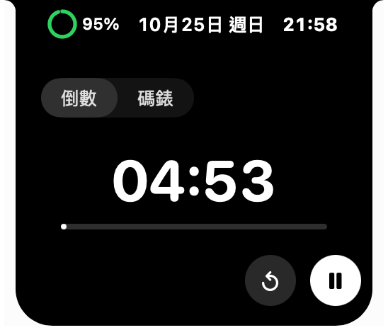 |
| **鏡子（需要相機權限）** | 鏡子小工具尚未取得相機權限時的畫面。 |  |
| **檔案中轉站** | 檔案中轉站分頁：左邊檔案抽屜，右邊 AirDrop 區。 | 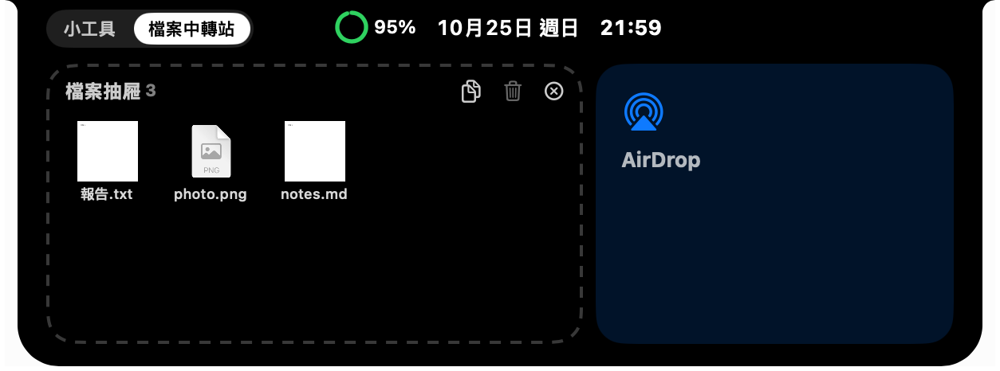 |

### 4. 單獨膠囊（只顯示一個小工具的詳細頁）

| 名稱 | 說明 | 圖 |
|---|---|---|
| **音樂獨立膠囊（有歌詞）** | 單獨膠囊：左邊播放器，右邊同步歌詞（目前行白色置中）。 | 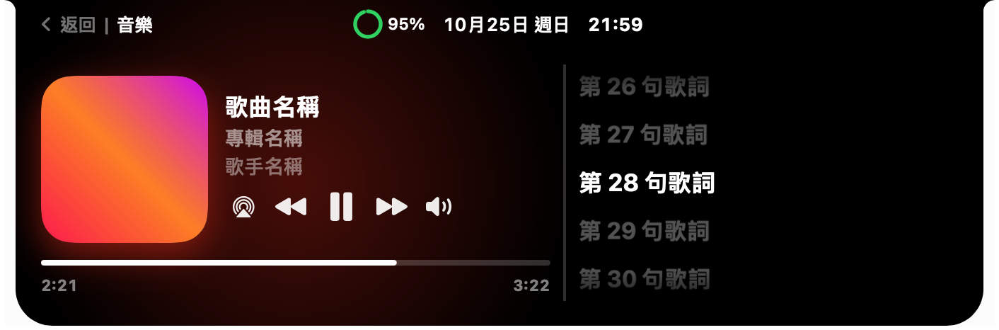 |
| **音樂獨立膠囊（無歌詞）** | 單獨膠囊：沒有歌詞時右邊顯示「沒有歌詞」。 | 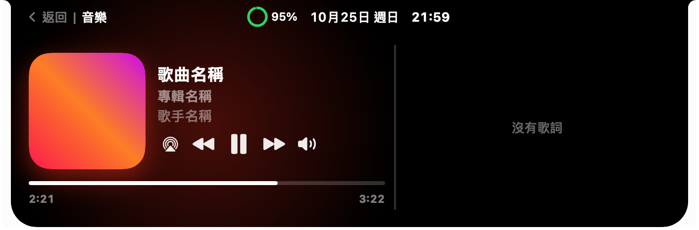 |
| **日曆獨立膠囊** | 單獨膠囊：日期條填滿寬度、今天靠左，活動以磚塊由左到右排列。 | 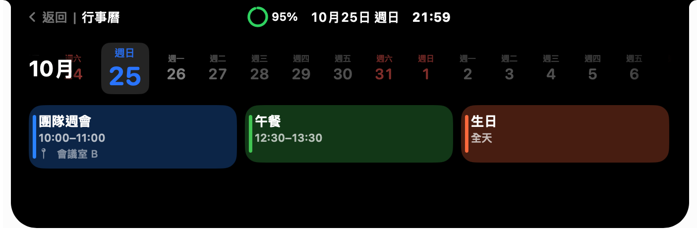 |
| **待辦事項獨立膠囊** | 單獨膠囊：左邊清單，右邊新增待辦輸入框。 | 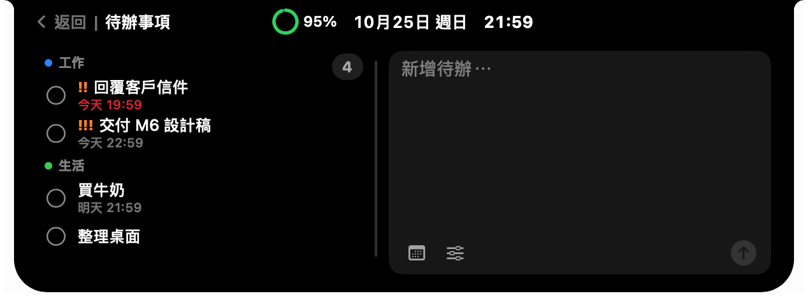 |
